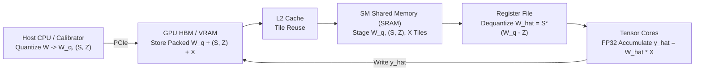

# Linear Layer Quantization & GPU Execution Visualizer

An interactive **React + TypeScript + Tailwind CSS** visualizer that walks step-by-step through how neural network weights in a linear layer ($y = Wx$) are **calibrated, compressed across BF16 / FP16 / FP8 / INT8 / INT4 / INT2, bit-packed in GPU HBM, streamed to SM Shared Memory, dequantized on-the-fly in registers, and multiplied in Tensor Cores**.

> Repository: [github.com/a-ramakrishnan/quantization](https://github.com/a-ramakrishnan/quantization)

## Try the walkthroughs

- The opening lesson offers a fixed-scale INT4 rounding experiment and a toy compression example with an explicit sparsity mask. **Compare weight configurations** opens two synchronized lanes with independent INT4, INT8, FP8, FP16, W8A16, and W8A8 settings for the same selected weight and row.
- In **Open lab → Advanced → Trace one weight**, select a cell from the live matrix. Use **Previous operation**, **Next operation**, or the scrubber to see the current value, the operation that produced it, and what happens next. Changes to the lab’s quantization settings feed the same walkthrough.
- **KV cache & GPU memory** estimates Qwen3.5-9B weight storage, full-attention cache, and fixed DeltaNet state on an NVIDIA A100 or L4. Weight precision, KV precision, context, and replica count are separate inputs.
- The compression example counts payload, mask, and scale bytes for eight weights. The 9B chart is a separate weight-storage estimate, and the inference views illustrate the arithmetic with simulated inputs.

---

## Guided 4-Stage Interactive Timeline

Instead of overwhelming you with every chart at once, the app unfolds as a progressive timeline (with a **Show All / Timeline View** toggle in the header):

1. **Stage 1 — Weights & Calibrate**
   - Pick a weight preset (*Normal*, *With Outliers*, *Shifted / Biased*, *Uniform*, *Random*) or edit any cell in the 4×4 FP32 weight matrix $W$.
   - Choose a target format along the precision ladder: **`BF16` → `FP16` → `FP8 (E4M3)` → `INT8` → `INT4` → `INT2`**.
   - For integer formats, configure **Symmetric vs. Asymmetric (Affine)**, **Per-Tensor / Per-Channel / Per-Group ($g=2$)** granularity, and **Outlier Clipping ($\alpha$)**.
   - Immediately see the **First-Level Output**: observed range, target integer bounds, **Scale ($S$)**, and **Zero-Point ($Z$)**.

2. **Stage 2 — Quantize & Format Journey (`FP32 → Target Format`)**
   - Side-by-side **FP32 ($W$) → Stored ($W_q$ / FP8 Hex / BF16 / FP16)** matrices with clipping indicators.
   - **Number-Line Bin Mapping**: Watch continuous FP32 weights snap to discrete integer buckets separated by $\Delta = S$.
   - **Live Step-by-Step Math Breakdown**: Exact numbers plugged into every formula for the selected cell (or sign/exponent/mantissa bit-field layout for BF16/FP16/FP8).
   - **Progressive Format Journey & INT4 Bit-Packing**:
     - Track an 8-weight Transformer row (or outlier row) across `FP32 → FP16 → BF16 → INT8 → Packed INT4`.
     - Inspect physical **INT4 nibble bit-packing** (two 4-bit two's-complement weights packed per byte, e.g. `-7, -6` → `1001 1010` → `0x9A`) and estimate **9B-parameter weight storage** with one FP16 scale per 128 integer weights (`36 GB` FP32, `18 GB` FP16/BF16, `9.14 GB` INT8, and `4.64 GB` INT4).

3. **Stage 3 — GPU Memory Hierarchy & On-the-Fly Dequantization**
   - **Break Down Boxes Independently**: Step through each hardware unit one by one (**Host CPU/Calibrator**, **GPU HBM/VRAM**, **L2 → SM SRAM**, **SM Register File Dequantizer**, **Tensor Core Accumulator**) to see how your weight row transforms inside each box.
   - **Reconstruct Together**: View the full unified **GPU Architecture & Dataflow** SVG diagram with animated data movement and clickable hardware inspector cards.



4. **Stage 4 — Linear Layer Forward Pass ($y = Wx$ vs. $\hat{y} = \hat{W}x$)**
   - Edit the FP32 input activation vector $x$ and compare true $y = Wx$ against quantized $\hat{y} = \hat{W}x$.
   - Inspect **Weight MSE**, **Weight SQNR (dB)**, **Output MSE**, **Cosine Similarity**, and **HBM Memory Savings**.

---

## Supported Formats at a Glance

| Format | Bits / Weight | Layout / Mapping | Scale Metadata | HBM Savings vs FP32 |
| :--- | :---: | :--- | :---: | :---: |
| **FP32** | 32 | `1S + 8E + 23M` | None | `1.0×` (baseline) |
| **BF16** | 16 | `1S + 8E + 7M` (wide range) | None | `2.0×` |
| **FP16** | 16 | `1S + 5E + 10M` (higher precision) | None | `2.0×` |
| **FP8 (E4M3)** | 8 | `1S + 4E + 3M` (max `±448`) | Optional | `4.0×` |
| **INT8** | 8 | `[-127, 127]` Sym / `[-128, 127]` Asym | $S$ (and $Z$) | `~4.0×` |
| **INT4** | 4 | `[-7, 7]` Sym / `[-8, 7]` Asym (2 per byte) | $S$ (and $Z$) | `~6.4× – 8.0×` |
| **INT2** | 2 | `[-1, 1]` Sym / `[-2, 1]` Asym | $S$ (and $Z$) | `~10.7× – 16.0×` |

---

## Getting Started

```bash
npm install
npm run dev
```

Build for production:

```bash
npm run build
```

## Contributing

Every check-in should go through a Pull Request:
1. Create a feature branch (`git checkout -b feat/your-feature`).
2. Commit your changes and run `npm run build` to verify TypeScript & Vite bundling.
3. Open a Pull Request against `main`.
