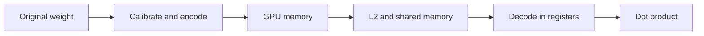

# Quantization Studio

An interactive guide to what happens when a model weight is stored with fewer bits. Follow one weight from calibration through GPU memory and into a dot product, then see how the same choices affect model storage and the KV cache.

[**Open the interactive studio**](https://a-ramakrishnan.github.io/quantization/) · [Compare configurations](https://a-ramakrishnan.github.io/quantization/?view=compare) · [Qwen3.5-9B memory calculator](https://a-ramakrishnan.github.io/quantization/?view=kv-cache)

## What you can explore

| View | Try this |
| --- | --- |
| **Opening lesson** | Follow the same BF16 weight through INT4, INT8, FP8, or FP16. Drag across a rounding boundary and watch two different weights land on the same code. |
| **Weight comparison** | Play two synchronized lanes through encoding, reconstruction, and the dot product. Start with W8A16 vs. W8A8 and watch identical INT8 weight bits feed different activation and compute paths. |
| **Basic lab** | Edit small query, key, and value projection matrices. Inspect the stored bits, decoded weights, and how each change affects the output. |
| **Advanced lab** | Calibrate a 4×4 matrix, choose symmetric or affine quantization, and test per-tensor, per-row, or per-group scales and clipping. Select **Trace one weight** to step through each operation. |
| **Compression experiment** | Compare dense BF16, dense INT4, and sparse INT4. The byte count includes packed codes, the shared scale, and the sparsity mask. |
| **KV-cache calculator** | Estimate Qwen3.5-9B memory on an NVIDIA L4 or A100. Change weight and cache precision independently, then vary context length and concurrency. |

## A weight’s journey

The Advanced lab follows the same selected weight through four stages. For integer formats, the CPU maps it to a code using scale `S` and zero-point `Z`. GPU memory carries the encoded bits. The illustrative register step reconstructs the weight as `ŵ = (q − Z) × S` before the dot product.



For example, Advanced INT4 can take `W[1,2] = −0.602`, store code `−4` in the high nibble of `0xC1`, and reconstruct `−0.6577143` with the active scale. **Box 4** shows both values and their difference. The illustration and calculator run in your browser using simulated values.

### From weight storage to inference memory

At 8,192 cached tokens per sequence, raw BF16 attention KV for Qwen3.5-9B takes **256 MiB per sequence**. Switching only the cache to 8-bit reduces that to **128 MiB**. The calculator budgets the fixed state of the 24 Gated DeltaNet layers separately from the growing KV of the 8 full-attention layers. It uses one full model replica per GPU and displays the budgeting assumptions alongside the estimate. [Qwen model config](https://huggingface.co/Qwen/Qwen3.5-9B/blob/main/config.json)

## Run locally

Use Node.js 24 with npm.

```bash
npm ci
npm run dev
```

```bash
npm test
npm run build
```

The app uses React, TypeScript, Tailwind CSS, Vite, and Vitest. GitHub Actions builds and tests pull requests. Pushes to `main` publish the static Vite build to GitHub Pages. [Deployment workflow](.github/workflows/pages.yml)

## License

[MIT](LICENSE)
