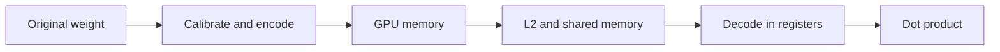

# Quantization Studio

An interactive guide to what happens when a model weight is stored with fewer bits. Follow one weight from calibration through GPU memory and into a dot product, then see how the same choices affect model storage and the KV cache.

[**Open the interactive studio**](https://a-ramakrishnan.github.io/quantization/) · [Compare configurations](https://a-ramakrishnan.github.io/quantization/?view=compare) · [KV-cache memory calculator](https://a-ramakrishnan.github.io/quantization/?view=kv-cache)

> **For academic and educational purposes.** We strive to keep the information up to date. Calculations and simulations are illustrative and depend on the inputs and assumptions shown. Published benchmarks describe specific workloads and systems. Verify the source specifications and measure your own workload before sizing a deployment.

## What you can explore

The home page links directly to every walkthrough, lab, experiment, and calculator.

| View | Try this |
| --- | --- |
| **Opening lesson** | Follow the same BF16 weight through INT4, INT8, FP8, or FP16. Drag across a rounding boundary and watch two different weights land on the same code. |
| **Weight comparison** | Play two synchronized lanes through encoding, reconstruction, and the dot product. Start with W8A16 vs. W8A8 and watch identical INT8 weight bits feed different activation and compute paths. |
| **Next-word animation** | Enter your own text and predict two words locally with DistilGPT2. Approve the model and runtime downloads before the first prediction. The animation uses the model’s first-token scores to simulate an INT4 weight change. |
| **Basic lab** | Edit small query, key, and value projection matrices. Inspect the stored bits, decoded weights, and how each change affects the output. |
| **Advanced lab** | Calibrate a 4×4 matrix, choose symmetric or affine quantization, and test per-tensor, per-row, or per-group scales and clipping. Select **Trace one weight** to step through each operation. |
| **Compression experiment** | Compare dense BF16, dense INT4, and sparse INT4. Encode the kept codes with a Huffman tree, decode the packed bytes, and verify the same pruned dot product. Inspect the file and loaded weight sizes, including tree, mask, scale, and padding. |
| **KV-cache calculator and GPU planner** | Compare Qwen, Llama, GLM, Kimi, MiniMax, Thinking Machines Inkling, and Ai2 Olmo. Set active users and precision, compare required GPUs across context lengths, and explore published serving measurements. |

## A weight’s journey

The Advanced lab follows the same selected weight through four stages. For integer formats, the CPU maps it to a code using scale `S` and zero-point `Z`. GPU memory carries the encoded bits. The illustrative register step reconstructs the weight as `ŵ = (q − Z) × S` before the dot product.



For example, Advanced INT4 can take `W[1,2] = −0.602`, store code `−4` in the high nibble of `0xC1`, and reconstruct `−0.6577143` with the active scale. **Box 4** shows both values and their difference. The illustration and calculator run in your browser using simulated values.

### From weight storage to inference memory

At 8,192 cached tokens per sequence, raw BF16 attention KV for Qwen3.5-9B takes **256 MiB per sequence**. Switching only the cache to 8-bit reduces that to **128 MiB**. The calculator budgets the fixed state of the 24 Gated DeltaNet layers separately from the growing KV of the 8 full-attention layers. [Qwen model config](https://huggingface.co/Qwen/Qwen3.5-9B/blob/main/config.json)

The planner compares sharded model replicas across nine GPU configurations and ranks each context length by the fewest GPUs that fit the active requests in memory. The serving section shows measured time to first token, output throughput, and inter-token latency for the listed workloads and stacks.

## Run locally

Use Node.js 24 with npm.

```bash
npm ci
npm run dev
```

```bash
npm test
npm run build
```

The app uses React, TypeScript, Tailwind CSS, Vite, and Vitest. GitHub Actions builds and tests pull requests. Pushes to `main` publish the static Vite build to GitHub Pages. [Deployment workflow](.github/workflows/pages.yml)

## License

[MIT](LICENSE)
